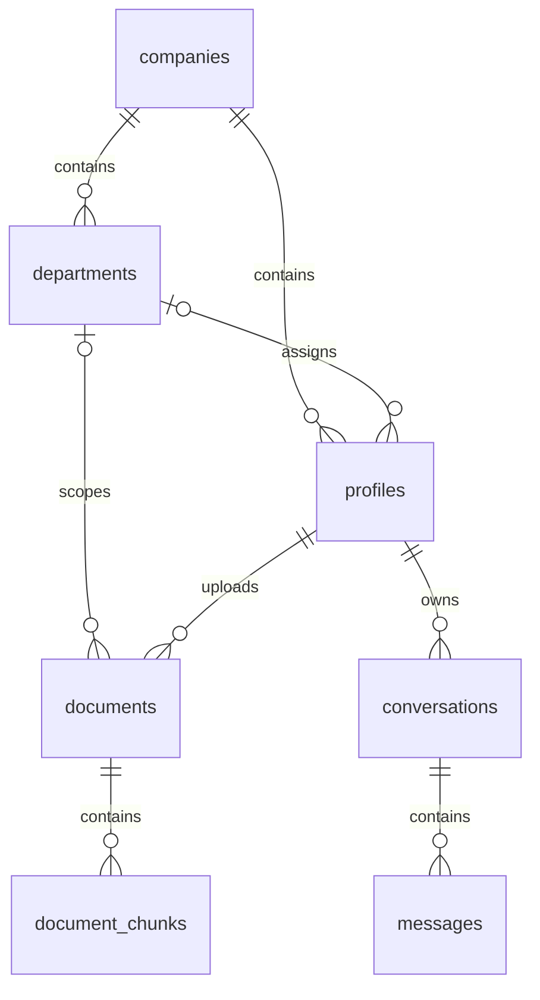

# Database and Storage design

The original two Foundation migrations are preserved; three additive migrations complete trusted product operations. **All five were executed only against disposable local PostgreSQL 17 / pgvector 0.8.1. No SQL ran against hosted `masar-dev`.**

| Table | Purpose and relationships |
| --- | --- |
| companies | Tenant root; one company per user identity |
| profiles | PK references `auth.users`; tenant + optional department; active flag; `company_admin` / `new_employee` role |
| departments | Company directory; composite company/id keys prevent cross-tenant associations |
| documents | Admin uploader, company/department visibility, immutable original object path/hash, size/MIME, draft/processing/published/failed/archived states and durable worker lease |
| document_chunks | Composite company/document FK, exact text, page/ordinal, vector and model/dimension integrity; cascade on document deletion |
| conversations | Company + owner FK; owner-only CRUD; unique initial request UUID per owner |
| messages | Composite company/conversation FK; role/content/exact citation references; UUID turn uniqueness; cascade with conversation |

## Migrations

1. `20261102000100_database_foundation.sql`: extension/enums/seven tables, composite FKs, CHECKs, timestamp triggers, indexes. RLS enabled/forced and broad browser grants revoked before committing.
2. `20261102000200_tenant_rls.sql`: four empty-search-path SECURITY DEFINER membership/read helpers in nonexposed `private`; tenant/owner/document access policies and narrowly scoped column grants.
3. `20261102000300_product_operations.sql`: upload hash uniqueness, durable processing leases, turn IDs/idempotent persistence, source access recheck, hybrid `search_chunks`, GIN lexical + 1024-dimensional BGE-M3 cosine HNSW index. Browser document/provenance/message writes revoked. Service-only INVOKER RPCs implement provisioning, worker publication, delete/retry and atomic turns.
4. `20261102000400_private_document_storage.sql`: private `company-documents` bucket, 5MiB/MIME constraints, allowed-document SELECT plus restrictive bucket guards against other broad object policies. Browser upload/update/delete denied. Fails if the existing bucket is public instead of silently changing it.
5. `20261102000500_administration.sql`: trusted role/activation/department changes (never self), and tenant-scoped document title/ACL management.

## Authorization matrix

| Operation | New Employee | Company Admin | Trusted backend/worker |
| --- | --- | --- | --- |
| Read company/departments | Own active company | Own active company | Necessary service operations |
| Edit own profile | Display name only | Display name only | Provision membership |
| Company/departments administration | Denied | Own company | Revalidate actor |
| Read documents/chunks/originals | Published company + own-department | Own company, all states | Processing only |
| Upload/publish/alter ACL | Denied | Via verified backend only | RPC rechecks admin; lease required for publishing |
| Manage roles/activation | Denied | Via backend, cannot modify self | Recheck active admin + same company |
| Read/write private history | Own only | Own only | Atomic turn writer validates owner/evidence |
| Embeddings/assistant messages | Browser writes denied | Browser writes denied | Trusted processor/validated generator |

Tenant identity never comes from body fields, Auth `user_metadata` or frontend role state. Supabase Auth validates the bearer at `/auth/v1/user`; caller JWT performs RLS-protected reads. Service credentials bypass RLS and therefore remain exclusively server-side. Trusted write RPCs have EXECUTE revoked from PUBLIC/anon/authenticated and recheck verified actors. Worker RPCs are service-only. `private` must not be exposed through PostgREST.

Storage objects are located at `companyUUID/documentUUID.ext`. Metadata checks require the company prefix and reject traversal/double slashes. Files upload before `uploaded_at` finalization, so workers cannot race incomplete uploads. Workers verify SHA-256 and byte bounds; publish chunks/status atomically only under the claimed lease. Stale processing leases can be reclaimed after ten minutes; failures require an admin retry. Delete first archives/cancels the lease (revokes reads), then removes the object, then deletes metadata/chunks; a failed object deletion remains archived and can be retried.

`save_turn` checks active membership, exact conversation ownership, each chunk/document tenant/visibility/published status and exact quote substring before inserting both messages transactionally. Replays do not duplicate turns; conflicting questions are rejected. History RLS hides an entire assistant message once any cited document is inaccessible. User questions remain private to their owner. Admins receive no exception to conversation privacy.

## Verification and limits

`python supabase/tests/run_local.py`: **81 original + 35 product assertions**, real local PostgreSQL, all migrations applied, RLS/role/cross-company probes, vector/lexical retrieval, storage policies, worker lease/publication and citation revocation. Fixtures transactionally roll back; seven tables empty; container/volumes removed. The harness provides only minimal local Auth/Storage schema compatibility, not a live Supabase gateway/Auth/Storage implementation.

Ordered migration files are one-time, separately transactional. An operator must inspect hosted schema/extensions/bucket compatibility and migration history before the deployment steps. Do not rerun SQL over existing tables or relocate an existing vector extension silently. Existing manual/prototype metadata without original files/hash/chunks is not automatically ingested. Existing service keys/migration owners can bypass RLS; protect and audit those credentials. Backups and restore drills are operator tasks before live rollout. No seeds, fake company records or hosted resources were created.
